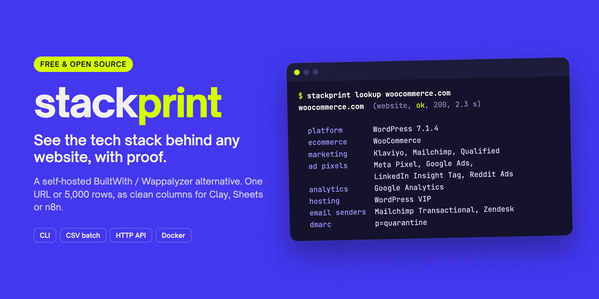

# stackprint



Open-source website technology detection. Give it a URL, get back the CMS, ecommerce platform, analytics, ad pixels, CRM, chat widget, payment processors, hosting, CDN and email provider, with the evidence for each.

A free, self-hostable alternative to BuiltWith and Wappalyzer, built for GTM work: every result is flat, single-valued fields that drop straight into Clay, rowbound, n8n or a spreadsheet.

```
$ stackprint lookup woocommerce.com
woocommerce.com  (website, ok, 200, 1.5 s)

  platform       WordPress 7.1.2
  ecommerce      WooCommerce
  wp theme       woo
  marketing      Klaviyo, Mailchimp, Qualified
  ad pixels      Meta Pixel, Google Ads, LinkedIn Insight Tag, Reddit Ads, The Trade Desk
  analytics      Google Analytics
  hosting        WordPress VIP
  ids            GA4 G-98K30SHWB2; GTM GTM-W64W8Q; Google Ads AW-878432221; Meta Pixel 743980872357899
```

## Why another one

- **Evidence, not guesses.** Every technology comes with the header, script, meta tag or DNS record that matched.
- **The back-office stack.** DNS says what a company pays for that its website never shows: the mailbox provider (and the security gateway in front of it), sending tools from SPF, and verified SaaS accounts from TXT records.
- **Sees inside Google Tag Manager.** Fast mode reads the site's public GTM container, so pixels injected by GTM show up without a browser.
- **Honest failures.** A Cloudflare challenge, a parked domain or a dead site is reported as exactly that, never as "no technologies".
- **Change over time.** Every scan is saved. The index records when each technology was first and last seen, so adopting or dropping a tool becomes a signal (`tech_added`, `tech_removed`).
- **Free and self-hosted.** No per-lookup fees, no account, AGPL so it stays open.

## How to use it

Pick the path that fits how you work.

| You want to... | Use |
|---|---|
| Try it without touching a terminal | [Let your AI agent install it](#let-your-ai-agent-install-it) |
| Check one site, or enrich a CSV of leads | [The command line](#the-command-line) |
| Add stack columns to Clay, Google Sheets or n8n | [The API](#the-api-for-clay-sheets-and-n8n) |

### Let your AI agent install it

If you use Claude Code, Cursor, Codex or another coding agent, paste this:

> Install stackprint from https://github.com/bolaji-ships/stackprint by following its README, then look up acme.com.

Then ask in plain English: "check every website in leads.csv and tell me which ones use HubSpot", or "what email provider does stripe.com use?"

### The command line

You need [Node.js](https://nodejs.org) 22.12 or later (the current LTS works). Then, once:

```bash
git clone https://github.com/bolaji-ships/stackprint.git
cd stackprint
npm install
npm run build
npm link                      # puts `stackprint` on your PATH
```

Look up one site:

```bash
stackprint lookup acme.com
stackprint lookup acme.com --json
```

Enrich a list. Point it at any CSV with a website column; it adds 66 columns (platform, email provider, CRM, ad pixels, tracking IDs, flags):

```bash
stackprint batch -i leads.csv -c website -o leads-enriched.csv
```

On a home connection, 100 company websites take about 30 seconds, so 5,000 take about 25 minutes. Reruns within 7 days come from the cache in seconds.

Some sites block plain requests (Cloudflare and similar). Deep mode loads the page in a headless browser instead. It needs Chromium once:

```bash
npx playwright install --only-shell chromium
stackprint lookup acme.com --deep
```

### The API (for Clay, Sheets and n8n)

`stackprint serve` runs the same lookups as an HTTP API on your machine. That is enough for Google Sheets (via [rowbound](#recipes)) and a local n8n. Clay calls from the cloud, so it needs stackprint on a public URL: deploy your own copy (see [Self-hosting](#self-hosting); Railway works out of the box), then follow the Clay [recipe](#recipes).

## How it works

1. **Classify the input.** Instagram profiles, Linktree pages, booking pages and marketplace listings are labelled and not scanned. Free subdomains (`*.vercel.app`, `*.wixsite.com`, `*.olitt.io`...) are scanned but their DNS is skipped, because it belongs to the platform.
2. **Collect, in parallel.**
   - The page: redirects, headers, cookies, HTML. HTTPS is tried first even when a listing says `http://`, then plain http. Invalid certificates are noted, not fatal.
   - DNS: MX, TXT/SPF, NS, SOA, CNAME, `_dmarc`, `autodiscover`, reverse DNS.
   - The TLS certificate, robots.txt, and up to three public GTM containers.
3. **Match** the signals against about 7,600 technology fingerprints: the community-maintained [webappanalyzer](https://github.com/enthec/webappanalyzer) data (Wappalyzer's format) plus a stackprint overlay of corrections and additions.
4. **Resolve** implied technologies (WooCommerce implies WordPress implies PHP), exclusions and confidence, then build the flat summary.
5. **Save** the scan to a local SQLite index and return JSON.

Deep mode also loads the page in headless Chromium. It records every network request, runs the JS-global and DOM checks inside the page, reads cookies set by JavaScript, and clicks "accept" on about 15 common cookie banners so consent-gated tags can load. Deep scans take 5 to 10 seconds against about 2 in fast mode.

## Output

Every top-level value is a single value (string, number, boolean or null), so one JSONPath or one column mapping gets each field. Lists are joined with ", ". Missing is `null`, never "Unknown" or "N/A". Names are copy-ready ("Meta Pixel", not "Facebook Pixel").

| Group | Fields |
|---|---|
| Status | `input`, `domain`, `final_url`, `url_type`, `url_platform`, `scan_status` (ok, partial, error, skipped), `error_code`, `http_status`, `mode`, `cached`, `scanned_at`, `fingerprints_version` |
| Flags | `has_website`, `has_custom_domain`, `has_ssl`, `has_mobile_viewport`, `has_tel_link`, `is_parked`, `is_site_builder`, `has_ecommerce`, `has_google_analytics`, `has_google_ads_tag`, `has_meta_pixel`, `has_whatsapp_widget`, `has_booking_widget`, `has_local_business_schema` |
| Stack | `tech_stack`, `tech_added`, `tech_removed`, `website_platform`, `platform_version`, `ecommerce_platform`, `page_builder`, `wp_theme`, `js_framework`, `hosting_provider`, `cdn`, `dns_provider`, `email_provider`, `email_gateway`, `email_senders`, `dmarc_policy`, `crm`, `marketing_automation`, `analytics`, `ad_pixels`, `chat_widget`, `payment_processors`, `booking_tool` |
| Tracking IDs | `ga4_ids`, `gtm_ids`, `google_ads_ids`, `ua_ids`, `meta_pixel_ids`, `tiktok_pixel_ids`, `linkedin_partner_ids`, `hubspot_portal_ids`, `klaviyo_company_ids`, `hotjar_ids`, `clarity_ids`, `adsense_ids` |
| Page | `page_title`, `meta_description`, `language`, `copyright_year`, `tech_count` |

The full view (default) adds `technologies[]` (name, display name, version, confidence, categories, evidence) and `details` (redirects, TLS, DNS records, WordPress theme and plugins, JSON-LD types, GTM containers, bot wall, consent, timings, warnings).

`error_code` values: `INVALID_URL`, `BLOCKED_TARGET`, `SITE_NOT_FOUND`, `CONNECTION_FAILED`, `TIMEOUT`, `CLOUDFLARE_BLOCKED`, `BOT_BLOCKED`, `RATE_LIMITED`, `HTTP_ERROR`, `NO_CONTENT`. A finished lookup always returns HTTP 200, even when the target site fails: "no website" is data.

## CLI

| Command | What it does |
|---|---|
| `stackprint lookup <url> [--deep] [--json \| --flat] [--fresh] [--no-store]` | One site. Results are cached (7 days) and saved to the local index. |
| `stackprint batch -i leads.csv [-c website] [-o out.csv] [--concurrency 8] [--deep]` | Every row of a CSV (or a .txt with one URL per line). Adds the flat fields as columns; `yes`/`no` for booleans, empty for null. Reruns are served from cache. |
| `stackprint sites <technology> [--all] [--csv]` | Sites in your index that use a technology (`stackprint sites hubspot`). |
| `stackprint domain <domain>` | One domain's technology history: first seen, last seen, removed. |
| `stackprint ids <kind> <value>` | Sites sharing a tracking ID (`stackprint ids ga4 G-XXXX`), which often means the same owner. |
| `stackprint serve [--host] [--port]` | The HTTP API. |
| `stackprint fingerprints info` | The fingerprint snapshot in use. |

The CLI reads settings from `~/.config/stackprint/.env` and keeps its index at `~/.local/share/stackprint/stackprint.db` (override with `DB_PATH`).

## HTTP API

```bash
stackprint serve                       # http://127.0.0.1:8787, no key needed on localhost
curl "localhost:8787/v1/lookup?url=acme.com&view=flat"
```

| Route | Notes |
|---|---|
| `GET /v1/lookup?url=&mode=&view=&fresh=` | `mode` fast or deep, `view` full or flat |
| `POST /v1/lookup` | Same, as a JSON body. Use this when URLs may contain `&` or `#` |
| `POST /v1/lookup/batch` | `{"urls": [...]}`, up to 25, fast mode |
| `GET /v1/technologies?q=` | Search the fingerprint catalog |
| `GET /v1/technologies/:slug/sites` | Reverse lookup over your index; `?format=csv`, `?all=true` |
| `GET /v1/domains/:domain` | History for one domain |
| `GET /v1/ids/:kind/:value/sites` | Sites sharing a tracking ID |
| `GET /health`, `GET /source` | No auth |

On any interface other than localhost the server requires API keys:

```bash
export STACKPRINT_API_KEYS='[{"name":"me","key":"<a long random string>","scopes":["lookup","deep","fresh","index"]}]'
```

Send a key as `Authorization: Bearer <key>` or `x-api-key: <key>`. Scopes: `lookup` (default), `deep`, `fresh` (bypass the cache), `index` (the reverse-lookup routes, which reveal what you have scanned). Keys are stored as sha256 hashes and compared in constant time. Each key is rate limited (`RATE_LIMIT_SCANS_PER_MIN`, default 60); over the limit you get `429` with `Retry-After`, and `503` when the scan queue is full.

## Recipes

**rowbound** (Google Sheets). Run `stackprint serve` on your machine: rowbound allows `http://localhost`, and your home connection is blocked less than cloud IPs. Add one action per column; after the first, they are cache hits.

```json
{
  "id": "platform",
  "type": "http",
  "target": "Website platform",
  "method": "POST",
  "url": "http://localhost:8787/v1/lookup",
  "headers": { "x-api-key": "{{env.STACKPRINT_KEY}}" },
  "body": { "url": "{{row.website}}", "view": "flat" },
  "extract": "$.website_platform"
}
```

**Clay.** Add an HTTP API column: `POST https://<your host>/v1/lookup`, body `{"url": "{{Website}}", "view": "flat"}`, header `x-api-key` from `Clay.secret()`. Read fields downstream as `{{stackprint}}?.email_provider ?? ""` (do not wrap in `String()`, which turns null into the text "null").

**n8n.** HTTP Request node, POST to `/v1/lookup` with the same body, then map fields from the JSON output.

**Lead lists.** `stackprint batch -i maps-export.csv -c website` on a Google Maps scrape gives you, per business: no website, site builder, no SSL, no mobile viewport, WhatsApp link, booking tool, Google Ads tag, Meta Pixel, copyright year.

## Self-hosting

```bash
docker build -t stackprint .                               # slim: fast mode only, ~95 MB compressed
docker build -t stackprint:browser --build-arg WITH_BROWSER=1 .   # with Chromium for deep mode
docker run -p 8080:8080 -v stackprint-data:/data -e STACKPRINT_API_KEYS='[...]' stackprint
```

| Variable | Default | |
|---|---|---|
| `HOST`, `PORT` | `::`, `8080` in Docker (`127.0.0.1`, `8787` for `stackprint serve`) | |
| `DB_PATH` | `/data/stackprint.db` in Docker | SQLite index; put it on a volume |
| `STACKPRINT_API_KEYS` | none | Required off localhost |
| `RATE_LIMIT_SCANS_PER_MIN` | 60 | Per key |
| `MAX_CONCURRENT_SCANS` | 4 | |
| `CACHE_MAX_AGE_DAYS` | 7 | Failures are cached for 6 to 24 hours |
| `DEEP_ENABLED` | false in Docker | Needs the browser image; plan for about 1 GB of RAM per concurrent deep scan |
| `DNS_SERVERS` | `1.1.1.1,8.8.8.8` | `system` to use the OS resolver |
| `SOURCE_URL` | this repository | Shown at `/source` and in `X-Source-Code` |

Railway works out of the box with the included `Dockerfile`, `railway.json` (health check on `/health`) and `.railwayignore`. Attach a volume at `/data` and run a single replica (SQLite has one writer).

## What it cannot see

- **Backend tools** such as Zapier, Make, n8n, Clay, Airtable or OpenAI's API leave no trace on a website. (A verified domain can still show up through DNS.)
- **Tags that wait for consent** stay invisible in fast mode. It tells you how many scripts are held back; deep mode clicks common consent banners.
- **Versions** are often hidden: many hosts strip headers like `X-Powered-By`.
- **Bot-protected sites** (Cloudflare, DataDome, Akamai...) may block automated requests. The result says so, with the DNS layer still filled in.
- Detection is only as good as the fingerprints. When something is wrong or missing, please contribute a fix (see [CONTRIBUTING.md](CONTRIBUTING.md)).

## Fingerprints

`fingerprints/upstream/` is a pinned, unmodified snapshot of [enthec/webappanalyzer](https://github.com/enthec/webappanalyzer) (commit in `UPSTREAM.json`). `fingerprints/overlay/` holds stackprint's additions and corrections in the same schema: African payment and commerce platforms (Paystack, Flutterwave, Monnify, Interswitch, Selar, Bumpa), local-services booking tools, email security gateways, fixes for false positives found in real scans, and merges of duplicate upstream entries. Refresh upstream with `npm run fingerprints:update -- --ref <commit>`; the script validates every regex and reports changes.

## Security

stackprint fetches whatever URL it is given, so it treats every target as hostile:

- Private, loopback, link-local and cloud-metadata addresses are refused. That includes obfuscated and IPv4-mapped forms, names that resolve to them, and redirects to them. Checks happen at connect time, which closes DNS rebinding.
- Only ports 80 and 443 are allowed.
- In deep mode every browser request passes the same guard, and the browser runs in a fresh context per scan.
- Deep mode runs untrusted third-party JavaScript, so give the `deep` scope only to keys you trust.

## License

stackprint is free software under the [GNU Affero General Public License v3.0 or later](LICENSE). If you run a modified version as a network service, you must offer its source to your users; `/source` and the `X-Source-Code` header exist for that.

The detection engine is ported from Wappalyzer (GPL-3.0) and the fingerprints come from webappanalyzer (GPL-3.0); see [THIRD_PARTY_NOTICES.md](THIRD_PARTY_NOTICES.md).
